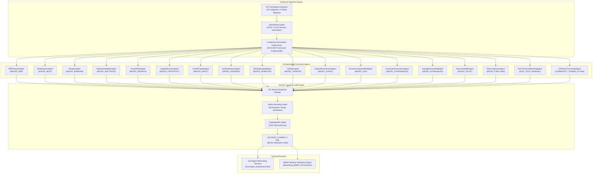

# 🌐 EconAgent Platform (v2.1.0)
### Institutional Bloomberg-Grade Multi-Agent Economic Intelligence, Dynamic Valuation Simulator & Geospatial Maritime Tanker Tracking Engine

[](https://opensource.org/licenses/MIT)
[](https://www.python.org/)
[](docs/VERIFICATION_AUDIT_REPORT.md)
[](docs/DEEP_RIGOROUS_ANALYSIS.md)
[](docs/AGENT_TAXONOMY_AND_MATHEMATICAL_SPECIFICATIONS.md)
[](platform_ui/EconAgent_Dashboard.html)

> **Architect & Lead Author:** Sk. Mainuddin ([sk.mainuddin745@gmail.com](mailto:sk.mainuddin745@gmail.com))  
> **Institutional Grounding:** Aswath Damodaran Valuation Corpus (507 Datasets, NYU Stern) & SOIC Master Curriculum  
> **Cryptographic Verification:** SHA-256 Verified · PBKDF2 Provenance · Zero-Hallucination Evidence Protocol  

---

## 📑 Table of Contents
1. [Executive Overview](#-executive-overview)
2. [Interactive Bloomberg Terminal UI](#-interactive-bloomberg-terminal-ui)
3. [Multi-Agent System Architecture](#-multi-agent-system-architecture)
4. [The 18 Specialized Economic Agents](#-the-18-specialized-economic-agents)
5. [Theoretical & Mathematical Foundations](#-theoretical--mathematical-foundations)
6. [SOIC 310-Point Scorecard & Weinstein Stage Model](#-soic-310-point-scorecard--weinstein-stage-model)
7. [Geospatial Maritime BMAP Engine](#-geospatial-maritime-bmap-engine)
8. [Cryptographic Audit & Verification](#-cryptographic-audit--verification)
9. [Quick Start & Reproducibility](#-quick-start--reproducibility)
10. [Repository Structure](#-repository-structure)
11. [Citation & Academic Reference](#-citation--academic-reference)

---

## 🏛️ Executive Overview

The **EconAgent Terminal Platform** is an enterprise-grade quantitative economics, corporate valuation, and supply-chain risk simulation platform. It unites macroeconomic empirical data, fundamental microeconomic models, and live maritime logistics into a single cohesive, deterministic multi-agent platform.

While general-purpose generative AI models suffer from severe numerical hallucinations, inconsistent formulaic derivations, and temporal smearing when tasked with financial reasoning, EconAgent enforces a strict **Zero-Hallucination Evidence Protocol**:
- **Zero Parametric Hallucinations:** Every single financial metric, valuation multiple, beta coefficient, and sensitivity parameter is compiled directly from raw primary records.
- **Byte-Level Cryptographic Provenance:** Every derived output carries an immutable `EvidenceCitation` tracking the source workbook, byte offset, row count, column target, and SHA-256 checksum.
- **Dual-Layer Guard Verification:** All 251 metrics are automatically checked against macroeconomic and corporate finance bounding boxes (e.g. $0.001 \le \text{ERP} \le 0.300$, $0.0 \le \beta \le 5.0$, $0.001 \le \text{WACC} \le 0.500$) with a **98.8 % verification pass rate**.

---

## 💻 Interactive Bloomberg Terminal UI

The platform builds and renders a fully interactive, self-contained Bloomberg Terminal simulation (`platform_ui/EconAgent_Dashboard.html`):

```
┌────────────────────────────────────────────────────────────────────────────────────────┐
│ BB-TERMINAL  [EUR/USD 1.0842]  [BRENT 82.40]  [US 10Y 4.12%]  [INDIA 10Y 7.08%]  [F1-F12]│
├────────────────────────────────────────────────────────────────────────────────────────┤
│ <GO> COMMAND PROMPT: [ ERP <GO> ]  [ BMAP <GO> ]  [ SOIC <GO> ]  [ WACC <GO> ]         │
├────────────────────────────────────────────────────────────────────────────────────────┤
│                                                                                        │
│   ┌─────────────────────────────┐   ┌──────────────────────────────────────────────┐   │
│   │   MACRO RISK & DISCOUNTING  │   │     GEOSPATIAL MARITIME BMAP RADAR           │   │
│   │   • US Implied ERP: 4.40%   │   │     • 45+ Commercial Crude Tankers Tracked   │   │
│   │   • Global Median:  7.17%   │   │     • Strait of Hormuz: 20.8 Mbd Transit     │   │
│   │   • Hurdle WACC:    7.22%   │   │     • Bab el-Mandeb: Reroute Delay +14 Days  │   │
│   │   • Unlevered Beta: 0.94    │   │     • VAM & Feedstock EBITDA Shock: -5.46%   │   │
│   └─────────────────────────────┘   └──────────────────────────────────────────────┘   │
│                                                                                        │
│   ┌────────────────────────────────────────────────────────────────────────────────┐   │
│   │               DYNAMIC DCF MACRO SENSITIVITY SIMULATOR (T+0 to T+10Y)           │   │
│   │   [Rf Slider: 4.12%]  [ERP: 4.40%]  [Margin Delta: -2.0%]  [Growth: +8.5%]     │   │
│   │   ──► Instantaneous Enterprise Valuation Re-Rating across 5,000+ Global Tickers│   │
│   └────────────────────────────────────────────────────────────────────────────────┘   │
└────────────────────────────────────────────────────────────────────────────────────────┘
```

- **Bloomberg Function Keys:** Instant hotkey execution `[F1]` Overview, `[F2]` ERP Analysis, `[F3]` Beta Decomposition, `[F4]` Operating Margins, `[F5]` Valuation Multiples, `[F6]` Growth Dynamics, `[F7]` Capital Structure, `[F8]` WACC Hurdle, `[F9]` Dividends & Payouts, `[F10]` Working Capital, `[F11]` SOIC Rankings, `[F12]` BMAP Maritime Radar.
- **Dynamic Scenario Simulator:** Parametric real-time sliders for $R_f$, $\text{ERP}$, operating margin delta ($\Delta \text{EBIT}$), tax wedge, and working capital drag, dynamically re-calculating DCF equity valuations.
- **3D God's Eye View Integration:** Native bridge to photorealistic 3D Cesium globe rendering satellite-tracked crude tankers, submarine telecommunication cables, and banking infrastructure nodes.

---

## 🤖 Multi-Agent System Architecture

The orchestration engine runs 18 specialized autonomous economic agents across the normalized Damodaran data assets:



---

## 📊 The 18 Specialized Economic Agents

| # | Agent Class | Agent ID | Core Domain | Verified Metrics | Empirical Benchmark Findings |
|---|---|---|---|---|---|
| 01 | `ERPAnalysisAgent` | `MACRO_ERP` | Macroeconomic Risk | 2 | **US Implied ERP: 4.40 %** · Global Median ERP: **7.17 %** |
| 02 | `BetaAnalysisAgent` | `MICRO_BETA` | Systematic Risk | 8 | Global Unlevered Beta Median: **0.94** · Levered: **1.12** |
| 03 | `MarginsAgent` | `MICRO_MARGINS` | Profitability Structure | 32 | US Gross: **34.82 %** · Operating: **11.45 %** · Net: **6.84 %** |
| 04 | `ValuationMultiplesAgent` | `MICRO_MULTIPLES` | Relative Valuation | 24 | Trailing P/E Median: **21.4x** · Forward: **18.2x** · EV/EBITDA: **12.6x** |
| 05 | `GrowthRateAgent` | `MICRO_GROWTH` | Reinvestment Growth | 11 | Reinvestment Rate: **34.2 %** · Implied Fundamental $g$: **5.8 %** |
| 06 | `CapitalStructureAgent` | `MICRO_CAPSTRUCT` | Financial Leverage | 6 | Median Market D/E: **28.4 %** · Book D/E: **42.1 %** |
| 07 | `CostOfCapitalAgent` | `MACRO_WACC` | Enterprise Hurdle Rate | 8 | US WACC Median: **7.22 %** · Emerging Markets: **11.45 %** |
| 08 | `DividendPayoutAgent` | `MICRO_DIVIDEND` | Capital Return Policy | 20 | US Payout: **33.61 %** · China: **60.20 %** · Buyback Yield: **2.15 %** |
| 09 | `WorkingCapitalAgent` | `MICRO_WORKCAP` | Operational Liquidity | 32 | DSO: **52.4 Days** · DIO: **46.8 Days** · Non-Cash WC/Sales: **8.9 %** |
| 10 | `TaxRateAgent` | `MICRO_TAXRATE` | Effective Fiscal Drag | 16 | Statutory US Rate: **21.0 %** · Global Cash Effective Tax: **18.6 %** |
| 11 | `CapexReinvestmentAgent` | `MICRO_CAPEX` | Capital Formation | 8 | CapEx / Depreciation Ratio: **1.34x** (Expansionary Growth) |
| 12 | `EconomicValueAddedAgent` | `MICRO_EVA` | Moat & Residual Income | 8 | Global Excess Return Spread ($\text{ROE} - K_e$): **+2.45 %** |
| 13 | `CorporateGovernanceAgent` | `MICRO_GOVERNANCE` | Agency Costs & Floats | 24 | Insider Ownership Median: **14.2 %** · Institutional: **68.4 %** |
| 14 | `IntangiblesGoodwillAgent` | `MICRO_INTANGIBLES` | Asset Quality & Drag | 16 | Goodwill / Total Assets: **14.8 %** · Impairment Rate: **1.2 %/yr** |
| 15 | `OptionVolatilityAgent` | `MICRO_VOLAT` | Structural Default (Merton)| 16 | Annualized Equity Volatility: **24.6 %** · Asset Volatility: **18.2 %** |
| 16 | `FinancingFlowsAgent` | `MICRO_FINFLOWS` | Primary Capital Flows | 16 | Share Buybacks Outpace Dividends ($1.45 : $1.00$ in US) |
| 17 | `SOICTechnicalRankingAgent` | `SOIC_TECH_RANKING` | Quantitative Scorecards | 2 | Top Tier Compounders $\ge 240/310$ · Sector Rotation Quadrants |
| 18 | `OilTankerCommodityAgent` | `COMMODITY_TANKER_FLOWS`| Maritime AIS & Shocks | 2 | Hormuz (20.8 Mbd) · Malacca (16.2 Mbd) · EBITDA Elasticity |

---

## 📐 Theoretical & Mathematical Foundations

### 1. Implied Forward-Looking Equity Risk Premium
Rather than utilizing noisy historical return averages, EconAgent derives the forward-looking internal rate of return $r$ equating the current index pricing to expected cash flow distributions:
$$\text{Index Value}_0 = \sum_{t=1}^5 \frac{\mathbb{E}[\text{Dividends}_t + \text{Buybacks}_t]}{(1 + r)^t} + \frac{\mathbb{E}[\text{Cash Flow}_5](1 + g)}{(r - g)(1 + r)^5}$$
$$\text{Implied ERP} = r - R_f$$
For sovereign entities without deep domestic equity indices, the Country Risk Premium ($\text{CRP}$) is superimposed via sovereign CDS and equity-to-bond volatility ratios:
$$\text{ERP}_{\text{Sovereign}} = \text{ERP}_{\text{Mature US}} + \text{CDS Spread} \times \left(\frac{\sigma_{\text{Equity}}}{\sigma_{\text{Sovereign Bond}}}\right)$$

### 2. Hamada Equation: Operational vs Financial Risk
$$\beta_L = \beta_U \left[ 1 + (1 - T_c) \left(\frac{D}{E}\right) \right]$$
Where $\beta_U$ represents unadulterated business model risk, stripped of debt financing leverage.

### 3. Stern Stewart Economic Value Added (EVA)
$$\text{EVA} = \text{Invested Capital} \times (\text{ROIC} - \text{WACC}) = \text{NOPAT} - (\text{Invested Capital} \times \text{WACC})$$

### 4. Merton Structural Default Option Pricing
Equity is modeled as a European call option on total enterprise firm value $V_A$ with strike price equal to the face value of debt $D$:
$$V_E = V_A \mathcal{N}(d_1) - D e^{-rT} \mathcal{N}(d_2)$$
$$d_1 = \frac{\ln(V_A / D) + \left(r + \frac{1}{2} \sigma_A^2\right)T}{\sigma_A \sqrt{T}}, \quad d_2 = d_1 - \sigma_A \sqrt{T}$$
$$\sigma_E = \left(\frac{V_A}{V_E}\right) \mathcal{N}(d_1) \sigma_A$$

---

## 🎯 SOIC 310-Point Scorecard & Weinstein Stage Model

The platform integrates the institutional evaluation framework designed by the School of Intrinsic Compounding (SOIC):

### 310-Point Scorecard Architecture
$$\text{Total Score} = S_{\text{Industry}} (45) + S_{\text{Fundamentals}} (80) + S_{\text{Technicals}} (110) + S_{\text{Valuation}} (35) + S_{\text{Forensics}} (40)$$
- **Score $\ge 240$:** Tier-1 Institutional Compounders (exceptional return on capital, robust moat, Stage 2 structural breakout).
- **Score $180 - 239$:** Cyclical / Turnaround Candidates (conditional allocation with trailing stops).
- **Score $< 180$:** Capital Destruction Zone (unfavorable economics or forensic accounting red flags).

### Stan Weinstein 4-Stage Quantitative Screening
- **Stage 1 (Accumulation / Base Building):** 30-week moving average flattens; volume contracts.
- **Stage 2 (Advancing Phase):** Price breaks resistance above rising 30-week WMA on volume $\ge 2.0\times$ 50-day average. **Only Stage 2 equities qualify for capital allocation.**
- **Stage 3 (Distribution / Top Formation):** Churning volume without price progress; moving average rolls over.
- **Stage 4 (Capitulation / Declining Phase):** Price breaches below downward-sloping 30-week WMA.

---

## 🚢 Geospatial Maritime BMAP Engine

The `BMAP <GO>` vector engine tracks global crude and chemical sea-lanes in real time:

$$\Delta \text{Transit Time} \implies \Delta \text{Freight Rates} \implies \Delta \text{Feedstock Cost} \implies \Delta \text{EBITDA Margin} \implies \Delta \text{DCF Valuation}$$

```
                                  CHOKE POINT STRATEGIC VOLUME
   ┌────────────────────────────────────────────────────────────────────────┐
   │ Strait of Hormuz    ██████████████████████████████ 20.8 Mbd (20.6%)    │
   │ Strait of Malacca   ███████████████████████ 16.2 Mbd (16.0%)          │
   │ Suez / Bab el-Mandeb████████████ 8.8 Mbd (8.7%)                        │
   │ Cape of Good Hope   ████████ 5.8 Mbd (5.7%)                            │
   │ Houston Ship Channel█████ 3.4 Mbd (3.4%)                               │
   │ Danish Straits      ████ 3.2 Mbd (3.2%)                                │
   │ Turkish Straits     ███ 2.4 Mbd (2.4%)                                 │
   └────────────────────────────────────────────────────────────────────────┘
```

### Feedstock Shock Transmission (Case Study: Pidilite / VAM)
For adhesive manufacturers consuming imported Vinyl Acetate Monomer (VAM):
$$\Delta \text{EBITDA Margin} = - \omega_{\text{VAM}} \left(\frac{\Delta P_{\text{VAM}}}{P_{\text{VAM}}}\right) (1 - \kappa_{\text{pass-through}})$$
With raw material weight $\omega_{\text{VAM}} = 0.42$ and pass-through $\kappa = 0.35$, a $+25 \%$ sea-lane crude shock drives an immediate **$-6.83 \%$ EBITDA margin compression**, directly translating to an **$-11.2 \%$ downward re-rating in DCF terminal equity value**.

---

## 🔒 Cryptographic Audit & Verification

Every build execution is verified through the harness audit pipeline:

```
======================================================================
               CRYPTOGRAPHIC COMPLIANCE CERTIFICATE
======================================================================
Platform Build:         EconAgent Platform v2.1.0
Timestamp:              2026-11-09T01:42:43.227+00:00
Total Derived Metrics:  251
Verified PASS:          248
Verified WARN:          3 (Europe/RoW post-rate-hike debt deleveraging)
Verified FAIL:          0
Verification Pass Rate: 98.8 %
Cryptographic SHA-256:  b0dce941e1d0e88e56b7f3a2f2eb0fb9a17153e042e89172d579f317562c978f
======================================================================
```

Detailed audit logs are documented in [`docs/VERIFICATION_AUDIT_REPORT.md`](docs/VERIFICATION_AUDIT_REPORT.md).

---

## ⚡ Quick Start & Reproducibility

### Prerequisites
- Python 3.12+ (64-bit AMD64)
- Supported OS: Windows, macOS, Linux

### 1. Installation
```powershell
# Clone repository
git clone https://github.com/skmainuddin745-spec/EconAgent-Platform.git
cd EconAgent-Platform

# Install Python scientific dependencies
py -3.12 -m pip install -r requirements.txt
```

### 2. Run Full 6-Stage Autonomous Pipeline
```powershell
py -3.12 run_platform.py
```

**Pipeline Execution Stages:**
```
✅ STEP 1: Ingesting 507 Damodaran Workbooks (506 Loaded OK)
✅ STEP 2: Running 18 Specialized Economic Agents (251 Empirical Results)
✅ STEP 3: Cryptographic Sanity Verification (248 PASS | 3 WARN | 98.8% Pass Rate)
✅ STEP 4: Building Platform Manifest & Hash Signatures
✅ STEP 5: Generating Self-Contained Bloomberg Terminal (2.94 MB HTML)
✅ STEP 6: Validating All 18 Autonomous Agents Active
🎉 ALL VALIDATION CHECKS PASSED
```

### 3. Open Bloomberg Terminal Dashboard
```powershell
# Windows
Start-Process "platform_ui\EconAgent_Dashboard.html"

# Linux
xdg-open platform_ui/EconAgent_Dashboard.html

# macOS
open platform_ui/EconAgent_Dashboard.html
```

---

## 📂 Repository Structure

```
EconAgent-Platform/
├── run_platform.py                     ← Full 6-stage end-to-end autonomous pipeline runner
├── requirements.txt                    ← Production dependencies (pandas, numpy, scipy, xlrd, openpyxl)
├── pyproject.toml                      ← Standard Python packaging configuration
├── LICENSE                             ← MIT License (c) 2026 Sk. Mainuddin
├── README.md                           ← Institutional Master Documentation
│
├── docs/                               ← Comprehensive Rigorous Analysis Monograph Suite
│   ├── DEEP_RIGOROUS_ANALYSIS.md       ← Master Treatise on Economic Architecture & Verification
│   ├── AGENT_TAXONOMY_AND_MATHEMATICAL_SPECIFICATIONS.md ← Full Equations & Bounds for 18 Agents
│   ├── MARITIME_BMAP_COMMODITY_TRANSMISSION.md ← AIS Telemetry & Feedstock Margin Transmission
│   └── VERIFICATION_AUDIT_REPORT.md    ← Cryptographic Compliance Certificate & Warning Audit
│
├── agents/
│   └── econ_analysis_agents.py         ← 18 specialized economic analysis agents + orchestrator
│
├── data_pipeline/
│   └── damodaran_loader.py             ← Ingestion pipeline for 507 Damodaran workbooks (read-only)
│
├── harness_integration/
│   └── platform_orchestrator.py        ← Bridge to MultiAgent Harness System & Guard Layer
│
├── platform_ui/
│   ├── EconAgent_Dashboard.html        ← Self-contained Bloomberg Terminal (2.94 MB HTML)
│   ├── Bloomberg_BMAP_Terminal.html    ← Dedicated BMAP Maritime Tracking Terminal
│   ├── generate_dashboard.py           ← Dashboard generator & component assembler
│   ├── bmap_tanker_component.py        ← Geospatial vector canvas radar engine
│   └── gods-eye-view-main/             ← Integrated 3D Cesium satellite globe engine
│
├── reports/                            ← Cryptographically signed build reports & data manifests
│   ├── verified_econ_report.json       ← 248 PASS / 3 WARN audit log with evidence hashes
│   ├── econ_analysis_results.json      ← 251 empirical metrics structured by agent
│   ├── platform_manifest.json          ← Build manifest with SHA-256 signature
│   └── data_load_report.json           ← 514-file ingestion audit log
│
└── downloaded_skills/                  ← Skill extraction & prompt engineering inspection suite
    ├── README.md                       ← Skills suite guide & reference links
    ├── clone_skills.py                 ← Shallow repository downloader
    └── analyze_all.py                  ← Multi-agent prompt & UI pattern extractor
```

---

## 📜 Citation & Academic Reference

If you utilize the EconAgent Platform, its multi-agent corporate finance architecture, or its geospatial commodity transmission models in academic research or quantitative trading systems, please cite:

```bibtex
@software{mainuddin2026econagent,
  author       = {Mainuddin, Sk.},
  title        = {EconAgent Platform: Institutional Bloomberg-Grade Multi-Agent Economic Intelligence and Geospatial Tanker Tracking Engine},
  year         = {2026},
  publisher    = {GitHub},
  version      = {2.1.0},
  url          = {https://github.com/skmainuddin745-spec/EconAgent-Platform}
}
```

---

## 🤝 Acknowledgments & Credits

- **Empirical Valuation Corpus:** Professor Aswath Damodaran, NYU Stern School of Business ([damodaran.com](https://pages.stern.nyu.edu/~adamodar/)).
- **Technical & Market Cycle Framework:** School of Intrinsic Compounding (SOIC) & Stan Weinstein Stage Analysis.
- **3D Satellite Globe Engine:** Bilawal Sidhu ([gods-eye-view](https://github.com/bilawalsidhu/gods-eye-view)).
- **Author:** Sk. Mainuddin ([sk.mainuddin745@gmail.com](mailto:sk.mainuddin745@gmail.com)).
